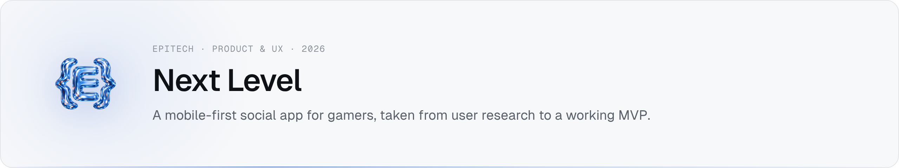

<picture><source media="(prefers-color-scheme: dark)" srcset="assets/banner-dark.png"></picture>

**Epitech Bachelor · Year 1 · Tech & Business Methodology (B-TBM-100) · Jan 2026**
Source code is private under Epitech's academic policy. Happy to walk you through the product process or demo the MVP → **imran.nogueira@gmail.com**

## Overview

Next Level lets players share clips and screenshots, interact with the community and **find teammates filtered by game and rank**. The project was run as a full product-design process: every phase is documented and fed the next, and the MVP only implements what survived prioritization.

## The product process

| Phase | Output |
|---|---|
| 01 Research | Problem statement, objectives, benchmark, interviews |
| 02 Personas | Casual player · Competitive player · Supervising parent |
| 03 User journey | Core flows mapped |
| 04–05 Wireframes & mockups | Low-fi then hi-fi screens |
| 06 Prototype | Interactive Figma prototype |
| 07 Feedback | User-testing protocol and results |
| 08 Prioritization | MoSCoW matrix, MVP scope |
| 09 Pitch | Final stakeholder pitch |

## MVP stack

| Layer | Tech |
|---|---|
| Front end | Next.js, React, JavaScript, Tailwind CSS, `next-themes` (light/dark) |
| Back end | Express + Mongoose, MongoDB |
| Media | Cloudinary uploads (images and clips) |
| Moderation | `leo-profanity` + `bad-words` on user-generated content |
| Hosting | AWS Amplify |

## MVP features

Community feed with media uploads · likes and comments · game search · teammate finder by game and rank · profile page · profanity filtering.

## Key decisions

- **Mobile first** — designed for thumbs, then adapted to desktop.
- **Scope cut by MoSCoW** — the MVP ships the must-haves from user testing, not the whole wish list.
- **Moderation built into the MVP** — user-generated content is filtered from the first version, not added later.

## Contact

Product walkthrough or MVP demo on request → **imran.nogueira@gmail.com** · [Portfolio](https://imran-nogueira.github.io)
